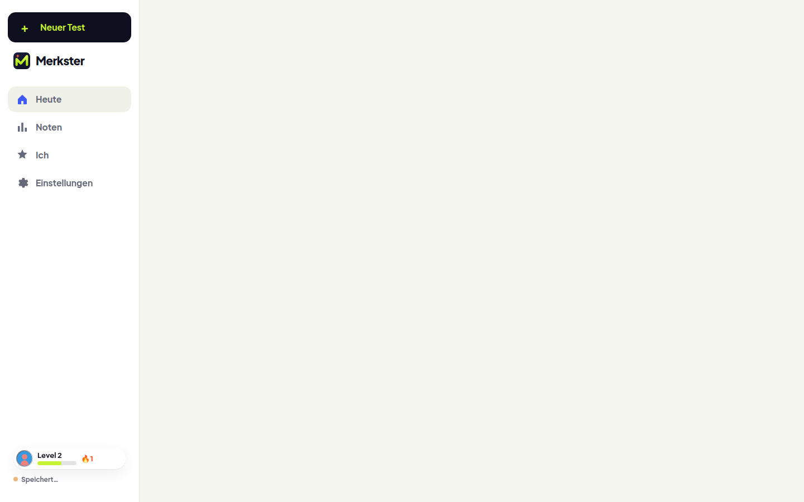
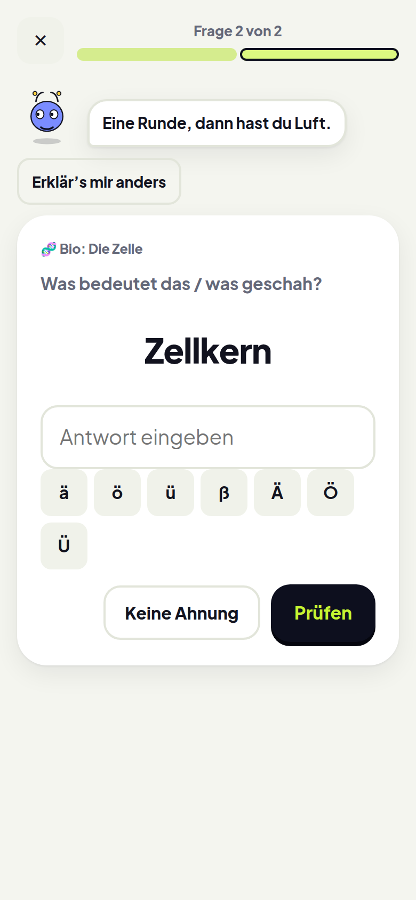
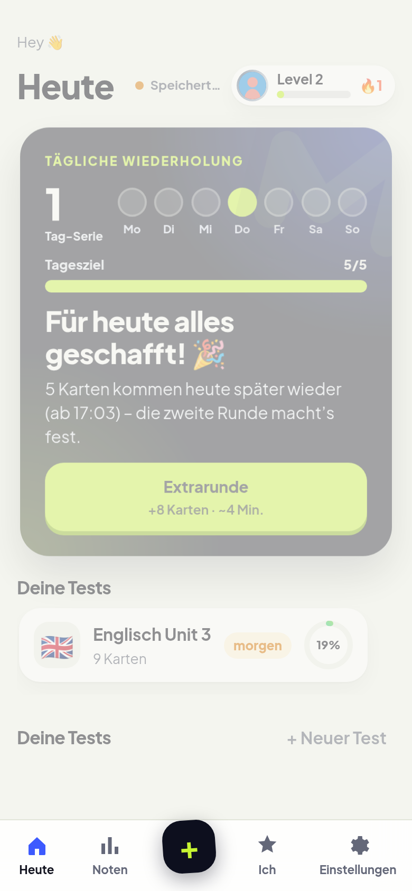
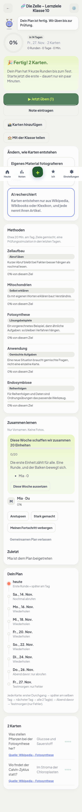

<p align="center"></p>

# Merkster

**Snap it. Drill it. Own the test.**

Photo a vocab list or a sheet of learning goals → practise until exam day.  
Merkster picks a method for each goal and keeps the plan paced to the exam.

> **Vibe coded** — this app was written with AI coding agents.  
> **LLM API needed** — photo → smart cards needs an OpenAI-compatible vision key (`LLM_BASE_URL` / `LLM_API_KEY` / `LLM_VISION_MODEL` in `.env`). Without it you only get on-device OCR, which is weaker on worksheets.

<p align="center">
  
</p>

<p align="center">
  
  &nbsp;&nbsp;
  
  &nbsp;&nbsp;
  
</p>

## Try it in two minutes

No Google account. No real LLM key. Mock sign-in + mock vision:

```bash
make mock-env        # creates a mock .env (stop here if you already have one)
make mock
make health          # → http://localhost:8080
```

Open the app → sign in with the mock login → add a test → practise.  
Done exploring? `make down`.

> Mock mode is for local try-outs only (`NODE_ENV=development`). Production refuses the mocks.

## Why people stick

| Student | Class |
|---|---|
| Cards from a photo, or a plan from a Lernziele sheet | Share one scan with the whole class |
| The method follows the kind of knowledge | Boss fights and vocab clashes |
| Practice that adapts when a day is missed | See a classmate’s progress on the same sheet |

## What you get

- **Import** — photo, PDF, or paste → review → cards  
- **Learning goals** — photo a Lernziele sheet for any subject. The app extracts the goals, asks only if something important is missing, picks a method, and builds the programme up to the exam  
- **Same sheet** — a second student can join that plan (own progress, same tasks) instead of generating it again  
- **Grades** — enter the mark after the exam (1–6, points, or percent) and see a success rate, trend, and plan vs no plan  
- **Practice** — successive relearning, tolerant checking, EN/DE  
- **Class** — share one scan with the whole class; XP board, boss fights, 1v1 clashes  
- **Offline PWA** — works without a signal; export or delete your data anytime  

## Run for real (Google sign-in)

```bash
make env
$EDITOR .env    # GOOGLE_CLIENT_ID + GOOGLE_CLIENT_SECRET, plus LLM_* for vision
make up
make health     # → http://localhost:8080
```

OAuth redirect: `<PUBLIC_URL>/api/auth/google/callback`  
Set `LLM_BASE_URL`, `LLM_API_KEY`, and `LLM_VISION_MODEL` for AI extraction (see [`.env.example`](.env.example)).  
Image: `ghcr.io/bandulix/merkster:latest` (also `0.1.2` / `0.1`)

HTTPS at home: set `DOMAIN` + `PUBLIC_URL`, then `make caddy`.

## Develop

```bash
npm ci && cp .env.example .env
npm run mock-oidc & npm run mock-llm &
npm run dev:server    # :8080
npm run dev:web       # :5173 → proxies /api
```

| | |
|---|---|
| `npm test` | unit tests |
| `npm run typecheck` | TypeScript |
| `npx playwright test` | E2E (set `CHROME_PATH` if needed) |

More in [CONTRIBUTING.md](CONTRIBUTING.md) · changes in [CHANGELOG.md](CHANGELOG.md).

## Privacy & kids

No ads. No tracking scripts. Classmates on a shared plan see a first name and, by default, a success rate — not each grade, and never a note.  
Export or delete under *Settings → Your data*. Host for others? Get parental consent where the law asks, and only send photos to an AI provider you’re fine with — or leave AI off.

## License

**AGPL-3.0-only** — see [`LICENSE`](LICENSE).  
Network use of a modified Merkster must offer the corresponding source (`SOURCE_CODE_URL`).
