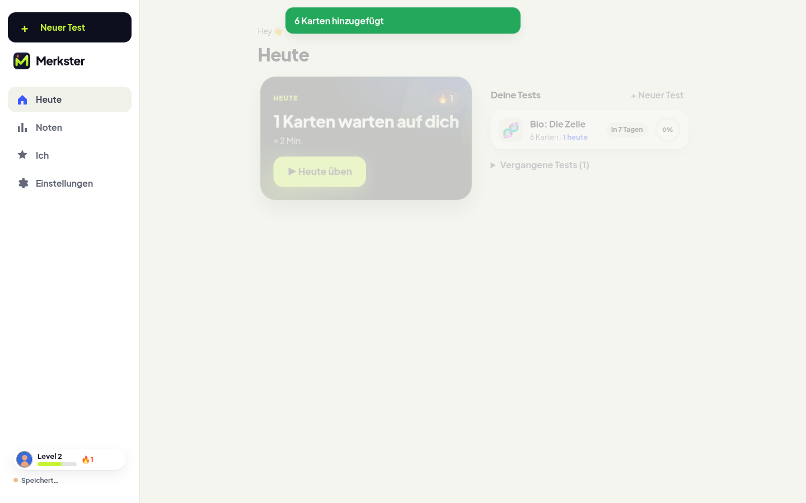
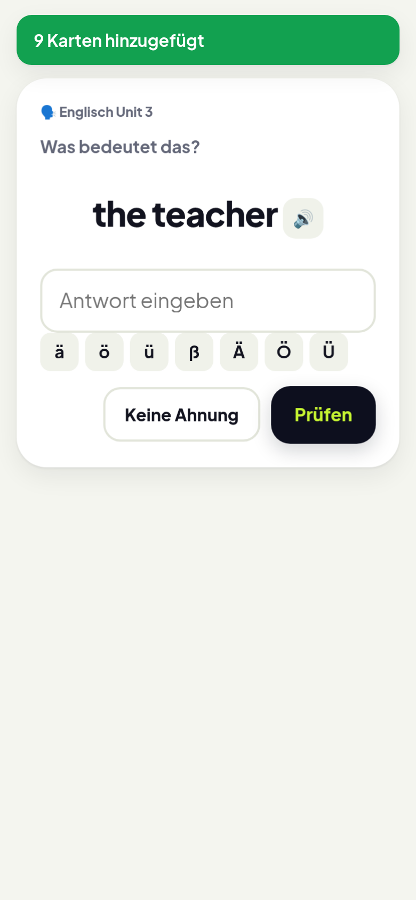
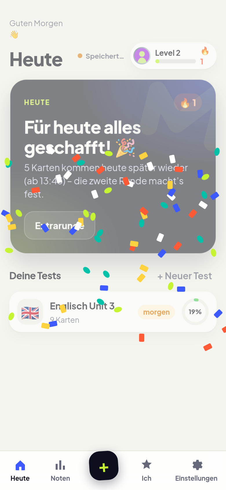
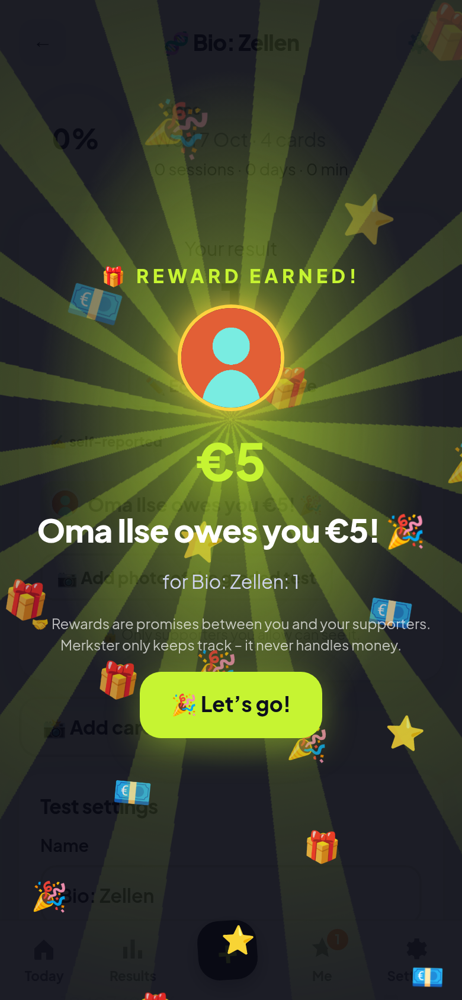

<p align="center"></p>

# Merkster

**Snap it. Drill it. Own the test. Earn the reward.**

Exam-prep PWA for students. Photo a worksheet, practise until the test, and let family promise a reward for the grade.  
Merkster tracks the promise. It never moves money. Self-hosted, open source, no ads, no tracking scripts.

<p align="center">
  <a href="LICENSE"></a>
  <a href="https://github.com/bandulix/merkster/releases/latest"></a>
  <a href="https://github.com/bandulix/merkster/pkgs/container/merkster"></a>
  <a href="CONTRIBUTING.md"></a>
</p>

<p align="center">
  
  
  
  
  
</p>

If Merkster helps you, a star helps others find it.  
Something off, or an idea? [Open an issue](https://github.com/bandulix/merkster/issues/new/choose) · see [CONTRIBUTING.md](CONTRIBUTING.md).

<p align="center">
  
</p>

<p align="center">
  
  &nbsp;&nbsp;
  
  &nbsp;&nbsp;
  
</p>

## Try it in two minutes

No Google account. No LLM key. Mock sign-in and mock vision, in Docker:

```bash
make mock-env && make mock
make health                   # → http://localhost:8080
```

`make mock-env` will not overwrite an existing `.env`. If you already have one, run `make mock`.  
Open the app → sign in with the mock login → add a test → practise.  
Done exploring? `make down`.

> Mock mode is for local try-outs only (`NODE_ENV=development`). Production refuses the mocks.

## Run for real (Google sign-in)

```bash
make env            # creates .env with random secrets (never overwrites)
$EDITOR .env        # GOOGLE_CLIENT_ID + GOOGLE_CLIENT_SECRET
make up             # pulls ghcr.io/bandulix/merkster:latest
make health         # → http://localhost:8080
```

OAuth redirect: `<PUBLIC_URL>/api/auth/google/callback`  
Image: `ghcr.io/bandulix/merkster:latest` (also `0.1.2` / `0.1`)  
HTTPS at home: set `DOMAIN` + `PUBLIC_URL`, then `make caddy`.

Photo → smart cards is optional. With no `LLM_BASE_URL` / `LLM_API_KEY` / `LLM_VISION_MODEL`, import uses on-device OCR (Tesseract): fine for vocab lists, weaker on other worksheets. For AI cards, point those three settings at any OpenAI-compatible endpoint that accepts images — a hosted API or a server you run (see [`.env.example`](.env.example)). The key stays on the server and is never sent to the browser.

## Why people stick

| Student | Family |
|---|---|
| Cards from a photo, not typing all night | Promise a reward for practice or the grade |
| Practice that adapts to the test date | Cheer from your phone when they crush a session |
| Class boss fights & vocab clashes with classmates | See grades/stats only if invited |

## What you get

- **Import** — photo, PDF, or paste → review → cards  
- **Practice** — successive relearning, tolerant checking, EN/DE  
- **Class** — share one scan with the whole class; XP board, boss fights, 1v1 clashes  
- **Family rewards** — rules for grades, practice, report cards (tracked, not paid out)  
- **Offline PWA** — after the first visit, the app works without a signal; export or delete your data anytime  

## Develop

```bash
npm ci && cp .env.example .env
npm run mock-oidc & npm run mock-llm &
npm run dev:server    # :8080
npm run dev:web       # :5173 → proxies /api
```

| | |
|---|---|
| `npm test` | unit tests |
| `npm run typecheck` | TypeScript |
| `npx playwright test` | E2E (set `CHROME_PATH` if needed) |

More in [CONTRIBUTING.md](CONTRIBUTING.md) · changes in [CHANGELOG.md](CHANGELOG.md).

> **Vibe coded.** This app was written with AI coding agents.

## Privacy & kids

No ads. No tracking scripts. Supporters see only what the student shares.  
Export or delete under *Settings → Your data*. Host for others? Get parental consent where the law asks, and only send photos to an AI provider you’re fine with — or leave AI off.

## License

**AGPL-3.0-only** — see [`LICENSE`](LICENSE).  
Network use of a modified Merkster must offer the corresponding source (`SOURCE_CODE_URL`).
