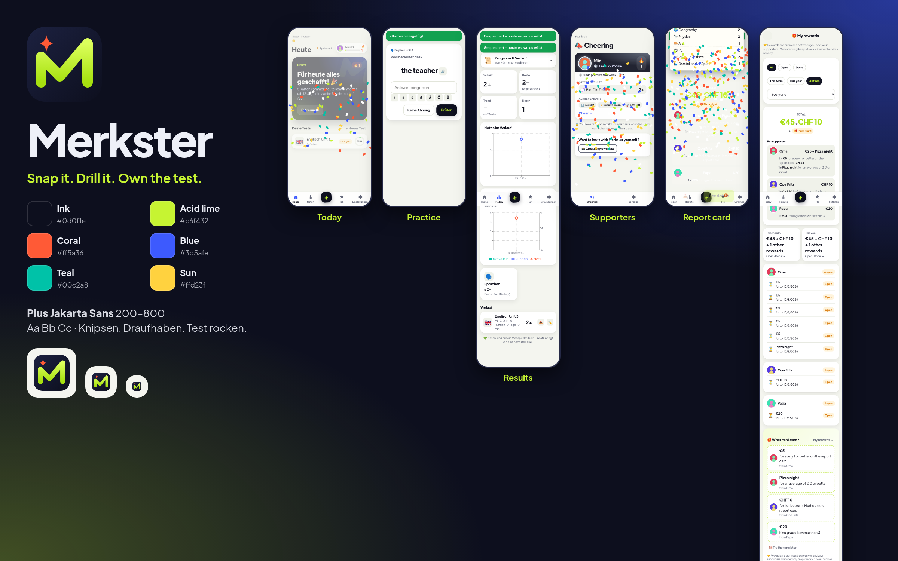

<p align="center"></p>

# Merkster

**Snap it. Drill it. Own the test.** – Merkster is an exam-prep PWA for students. Take a photo of a worksheet, a vocabulary list or a PDF (or paste text), and Merkster turns it into cards. You then practise with *successive relearning* (retry until correct, spaced over the days until the test), see how practice relates to your grades, and family members can cheer you on and promise rewards.



## Features

| | |
|---|---|
| **Import** | Photo / PDF / paste. On-device OCR (Tesseract, works offline) or – if configured – a server-side vision LLM. Always a review screen before anything is saved. |
| **Tests** | Each test has a date and a format (vocab, Q&A, mixed, articles). The *Today* dashboard plans what to practise. |
| **Practice** | Retry-until-correct sessions, tolerant answer checking (typos, articles, accents), text-to-speech, EN/DE UI. |
| **Results** | Self-reported exam results in 8 grading systems (DE 1–6 ±, Oberstufe 0–15 P, AT 1–5, CH 6–1 with halves, US A–F ±, UK GCSE 9–1, percent, x of y). Original value + normalised score. Results dashboard (Recharts). |
| **Report cards** | Photo of the *Zeugnis* → AI proposes subject lines (or a quick manual form) → review & match subjects (synonyms + fuzzy, confidence, one-tap new subject, ignore conduct lines) → confirm. Terms, report card vs. test average with a friendly gap explanation, trends, unboxing reveal, badges & XP, share card with *hide grades*. |
| **Gamification** | XP, levels, ranks, streaks with freezes, badges, share cards (PNG / short video). |
| **Supporters** | Invite family via an unguessable, expiring, limited-use, revocable link (Web Share, copy, QR). Supporters sign in with Google, see a read-only dashboard of what the student shares, react with emojis/preset messages. |
| **Rewards** | Supporters set rules (grade thresholds per subject, personal best, improvement, streak, level, report-card rules) with money (per currency) or free-text rewards and optional monthly caps. The student sees **one grand total plus a per-supporter breakdown** everywhere. *Merkster only tracks promises – it never moves money.* |
| **Simulator** | “What could I earn?” – play with expected report-card grades; the same rule engine computes the total per supporter. Clearly labelled *Simulation*; never creates rewards. |
| **Offline-first** | IndexedDB on the device, last-writer-wins sync per record, installable PWA with update prompt. |
| **Privacy** | Google sign-in only, GDPR export (JSON) and delete, supporter visibility switches, everything enforced server-side. |

## Quick start (Docker)

```bash
make env            # creates .env from .env.example with random APP_SECRET / POSTGRES_PASSWORD
$EDITOR .env        # add GOOGLE_CLIENT_ID / GOOGLE_CLIENT_SECRET (and optionally the LLM settings)
make up             # docker compose up -d --build  →  http://localhost:8080
make health
```

HTTPS with Caddy: set `DOMAIN=…` and `PUBLIC_URL=https://…` in `.env`, then `make caddy` (uses `docker-compose.caddy.yml`).

**Try it without Google or an LLM (test only):** `make mock-env && make mock` starts the app plus a mock Google provider (`tools/mock-oidc.mjs`) and a mock vision LLM (`tools/mock-llm.mjs`) via the compose profile `mock`. The server **refuses to start** with the mock provider when `NODE_ENV=production`.

### Google sign-in

1. Google Cloud console → *APIs & Services* → *OAuth consent screen* (External, scopes `openid email profile`).
2. *Credentials* → *Create OAuth client ID* → *Web application*.
3. Authorised redirect URI: `<PUBLIC_URL>/api/auth/google/callback`.
4. Put the client ID/secret into `.env`. Optional: `ALLOWED_EMAIL_DOMAINS`, `REGISTRATION_OPEN=false` + `ALLOWLIST`, `ADMIN_EMAILS`.

The flow is authorization code + PKCE, with `state` and `nonce`. Profile pictures (`picture` claim) are fetched at 256 px on each login, cached on our server and served same-origin (`/api/avatars/:id`, signed URL, long cache) – the browser never loads images from Google. Without a picture we show initials.

### AI extraction (optional)

Any OpenAI-compatible endpoint with vision: `LLM_BASE_URL`, `LLM_API_KEY`, `LLM_VISION_MODEL`. Keys stay on the server – they are never logged and never reach the client. Per-user rate limits: `AI_RATE_LIMIT_PER_HOUR` / `_PER_DAY`. Without AI the app uses on-device OCR and the manual report-card form.

## Development

```bash
npm ci
cp .env.example .env     # set APP_SECRET, DATABASE_URL (local Postgres 16), Google or mock settings
npm run mock-oidc & npm run mock-llm &   # optional test doubles
npm run dev:server       # Fastify on :8080 (auto-migrates)
npm run dev:web          # Vite on :5173 (proxy /api → :8080)
```

| command | |
|---|---|
| `npm test` | Vitest unit tests (grading systems, reward engine, report-card matching/terms, simulator == real evaluation, scheduler, checking, parsing, sync, server sanitisers, config safety) |
| `npm run typecheck` | TypeScript strict, web + server |
| `npx playwright test` | end-to-end (needs app + mocks running; set `CHROME_PATH` to use a system Chrome) |
| `make lint` | hadolint + `docker compose config` |

### End-to-end tests

- `flow.spec.ts` – login → import (AI) → review → practice → level-up → result → dashboard → share → persistence → isolation → offline.
- `supporters.spec.ts` – 3 accounts: invite → accept → cheer → privacy → revoke → removal; avatars; one supporter with several kids.
- `rewards.spec.ts` – “5 € per 1” (rule → earned on both sides → mark paid → verified → grading-switch warning) and report cards with **three supporters** (mock AI extraction → review/match → confirm → unboxing → grand total per currency + per-supporter breakdown → simulator never creates rewards → supporters only see their own amounts until the student allows it → reactions on the report card → photo permission).
- `ocr.spec.ts` – on-device OCR accuracy against `tests/fixtures/truth.json` (report in `tests/output/ocr-report.json`).

## Architecture

```
web/      React 18 + Vite PWA (react-router, TanStack Query, Recharts, vite-plugin-pwa)
shared/   pure TypeScript used by both sides: grading systems, reward engine, report cards, gamification, scheduler
server/   Fastify 5 (TypeScript, bundled with esbuild) – /api + serves dist/web; Postgres 16 with SQL migrations
tools/    mock Google OIDC provider + mock LLM (tests / local only)
```

- **Sync:** each record carries `updatedAt`; the server keeps the newest (LWW) and hands out changes since a revision.
- **Rewards:** one pure engine (`shared/rewards.ts`) – `evaluateRule` is used by the server (earning) and the simulator (what-if). Only events after a rule was created count; caps are per calendar month; an earned reward is unique per rule + source.
- **Report cards** are a server resource (supporters and rewards need them); lines are validated and scored on the server.
- **Security:** session cookie (`HttpOnly`, `SameSite=Lax`, `Secure` behind https), CSRF header on every mutating request, strict CSP (`img-src 'self' data: blob:`), invite tokens only in the URL fragment, all supporter access checks on the server, non-root container with a healthcheck.

## Privacy, children & parental consent

Merkster is used by school children. If you run it for others:

- **Data minimisation:** we store the Google account id, name, e-mail and picture; the student's tests, cards, practice history, results and report cards. No tracking, no ads, no third-party scripts.
- **Parental consent:** in the EU (GDPR Art. 8) children under 16 (13–16 depending on the member state) need a parent's consent for information-society services. Ask a parent to set up the account or to confirm, and make sure your privacy notice says who operates the server.
- **Supporters see only what the student shares:** results and practice can be switched off per supporter; photos of graded tests/report cards only if the student allows it; other supporters' rules and amounts are hidden unless the student switches on *Supporters can see each other*. Supporters can never change the student's data.
- **Rewards are promises:** Merkster only keeps track; it never handles money. Results are *self-reported* unless a supporter marks them *verified*.
- **Export & delete:** *Settings → Your data* downloads everything as JSON (incl. rewards and report cards) or deletes the account and all data (including supporter links, reactions, rewards, photos).
- AI extraction sends the photo to the LLM endpoint you configure – choose a provider with an appropriate data-processing agreement, or leave AI off.

## Configuration reference

See [`.env.example`](.env.example) – every variable is documented there. `.env` is never committed or included in release archives.

## License

Private / unreleased (UNLICENSED). Bundled third-party runtime files (Tesseract.js, PDF.js) keep their own licenses (copied to `web/public/vendor/*/LICENSE*`).
